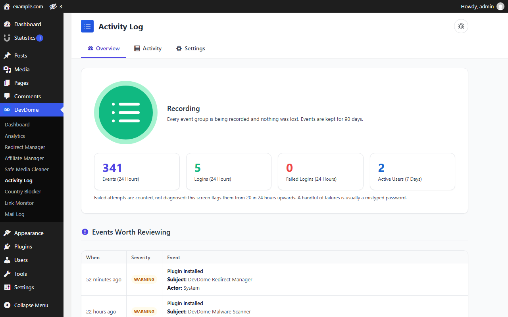
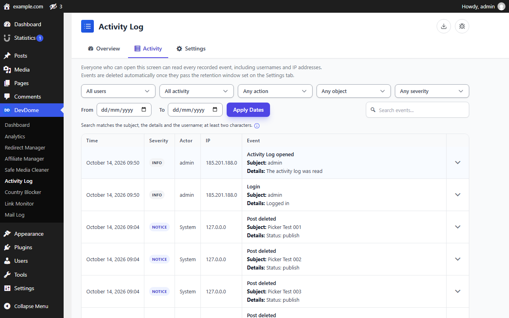
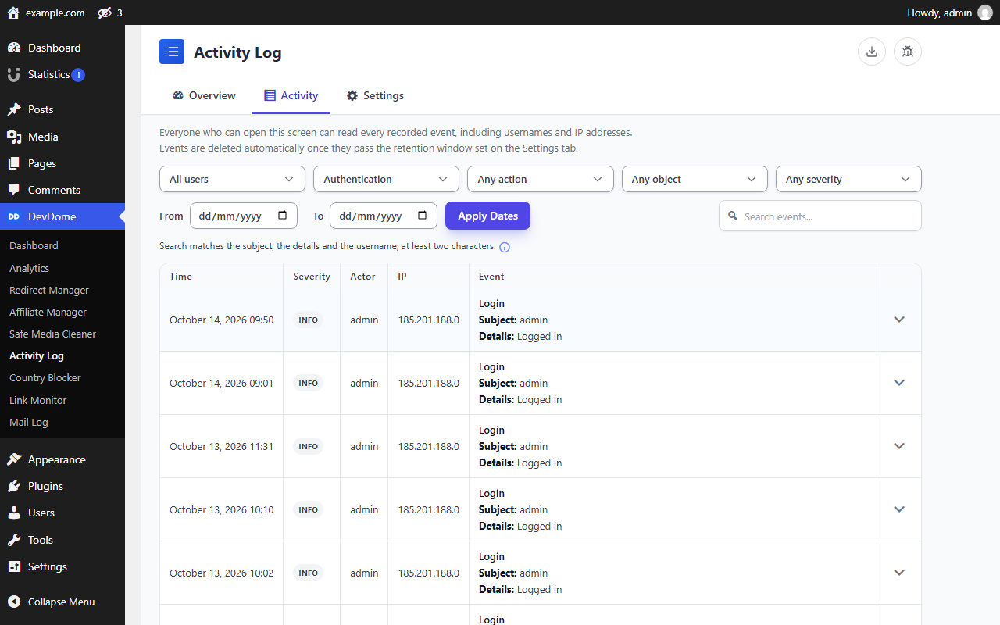
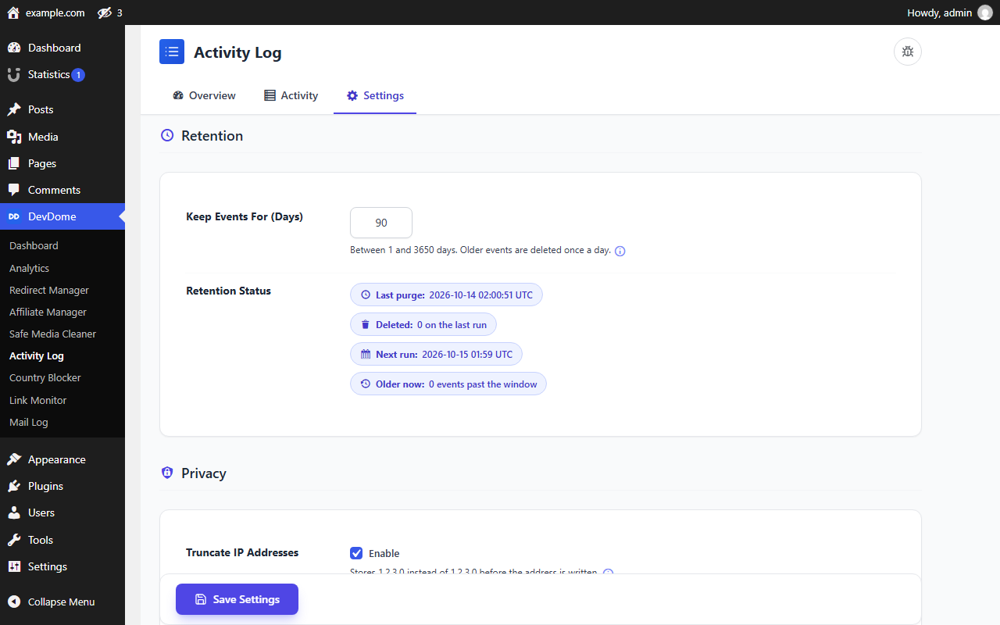

# DevDome Activity Log - free WordPress activity log, audit trail and user activity tracker

Track WordPress user activity in a local activity log: logins, logouts and failed login attempts, content changes, user and role changes, plugin, theme and core updates, media, comments and a fixed list of important settings. Filter by user, activity group, action, object, severity and date, search the log, and export the filtered view to CSV. Everything is recorded in a dedicated table in your own database, and the plugin publishes the full list of what it records and what it does not. Every feature is free, with no paid tier.

**The free alternative to WP Activity Log Premium and Logtivity for a WordPress audit log that stays on your own server.**

- **Install from WordPress.org:** https://wordpress.org/plugins/devdome-activity-log/
- **Website:** https://devdome.com
- **Support:** https://wordpress.org/support/plugin/devdome-activity-log/

## Why DevDome Activity Log instead of the alternatives

| | DevDome Activity Log | WP Activity Log | Logtivity | Activity Log (Aryo) | Simple History | Stream |
|---|---|---|---|---|---|---|
| Price | **Free** | Premium $139 / year | $6 / year per site (hosted service) | Free | Free core, paid add-ons | Free |
| Log stored only on your own server | Yes | Yes (external database is a paid tier) | No, hosted dashboard | Yes | Yes | Yes |
| Search filters free | **Yes** | Premium | Search (filters not stated) | Yes | Yes | Yes |
| CSV export | **Yes, free** | Premium (reports) | Yes | Yes | CSV / JSON, tier not stated | Yes, CSV / JSON |
| Published list of what is NOT recorded | **Yes** | Not stated | Not stated | Not stated | Not stated | Not stated |
| Failed logins counted per source, per hour, in one atomic statement | **Yes** | Not stated | Not stated | Not stated | Not stated | Not stated |
| Truncated IP addresses by default, credential values redacted before storage | **Yes** | Not stated | Not stated | Not stated | Not stated | Not stated |
| WordPress Abilities API / MCP tools for AI agents | **11 abilities** | Not stated | Not stated | Not stated | Not stated | Not stated |

Prices and feature rows come from the vendors' published plans and WordPress.org listings in October 2026. "Not stated" means the listing does not say; it is not a claim that the feature is missing.

## What it records

- **Authentication:** logins, logouts, failed login attempts, password reset requests and completed resets. Repeated failed logins and reset requests are counted into one row per source, per attempted account, per hour by a single atomic database statement.
- **Users:** accounts created and deleted, roles set, added and removed, email changes (both addresses masked) and other profile changes. Passwords are never recorded.
- **Content:** posts, pages and custom post types created, updated, trashed, restored or deleted, with a summary of what changed. Bodies are compared by hash and never stored.
- **Plugins, themes and core:** installs, updates with the previous and new version, activations, deactivations, deletions, theme switches and core updates. Failed updates are recorded as failed.
- **Media and comments:** uploads, deletions and comment status changes.
- **Settings:** a fixed allowlist of nine important options, such as site URL, admin email, open registration, default role and the site time zone.
- **The log itself:** every policy change, CSV export, retention purge, personal-data erasure and storage migration. These cannot be switched off by the settings they describe.

The readme lists what is **not** recorded, so there is no ambiguity: comment creation and editing, media edits, term, menu, widget and Customizer changes, application passwords, session destruction and more. Anything not on the coverage list is not recorded.

## Features

### User activity log with filters, search and CSV export

Filter by user, activity group, individual action, object type, severity and date range, or search the object, details and username columns. Filters are reflected in the URL. Export the current filtered view to CSV; every cell is neutralised against spreadsheet formula execution.

### Privacy by default

IP addresses are truncated by default (1.2.3.0 instead of 1.2.3.4). Values that look like credentials are replaced with `[redacted]` before anything is stored. Email addresses in user events are masked. Full IP addresses are shown only to users who hold the IP-viewing capability. WordPress personal-data exports include the account's activity records; a personal-data erasure clears the username, user ID and IP from them.

### Access control and retention

Reading, exporting, changing policy, purging, diagnostics, repair and viewing full IPs are seven separate capabilities, granted to administrators on activation. Old events are deleted by a daily retention purge with a window you choose, from 1 to 3650 days (default 90). Roles and usernames can be excluded from logging.

### Honest about its limits

The log is a normal database table; anyone with database access can edit it and the plugin does not claim to be tamper-proof. There is no email alerting, no real-time notification, no network-wide multisite screen and no background export job. The readme states each of these.

## AI agents and MCP (WordPress Abilities API)

On WordPress 6.9 and newer the plugin registers eleven abilities through the [WordPress Abilities API](https://developer.wordpress.org/apis/abilities-api/) and lists them as tools on the official [WordPress MCP Adapter](https://github.com/WordPress/mcp-adapter): `get-status`, `get-settings`, `get-events`, `get-recent-activity`, `get-user-activity`, `get-login-events`, `get-plugin-changes`, `find-suspicious-changes`, `update-settings`, `run-purge` and `repair-storage`. Every read checks the same capabilities as the screen; writes that weaken logging or delete data require confirmation.

## Screenshots

*Overview: recording status, the last 24 hours in numbers and the events worth reviewing.*

*Activity: every recorded event with time, severity, actor, IP and details, filtered or searched.*

*Authentication events only.*

*Settings: retention and privacy.*

## Requirements

WordPress 6.0+, PHP 7.4+. The Abilities API integration needs WordPress 6.9+. No account is required; the log works entirely on your own server.

## Installation

1. In wp-admin, open **Plugins > Add New**, search **DevDome Activity Log**, install and activate.
2. Open **DevDome > Activity Log**. Recording starts on activation; the Settings tab holds retention and privacy.

## Part of the DevDome plugin family

Free WordPress plugins by [DevDome](https://devdome.com): Analytics (cookieless, bot/AI crawler split, public API and MCP server), Redirect Manager, Media Cleaner, Link Monitor, Affiliate Manager, Malware Scanner, Admin Cleaner, Country Blocker, Bot Protection and Activity Log.

Every plugin includes the DevDome Dashboard in wp-admin for one-click installation of the others.

## Development

This repository mirrors the WordPress.org release. Open an issue for bugs or feature requests, or use the [support forum](https://wordpress.org/support/plugin/devdome-activity-log/).

## License

GPL-2.0 or later. See [LICENSE](LICENSE).
